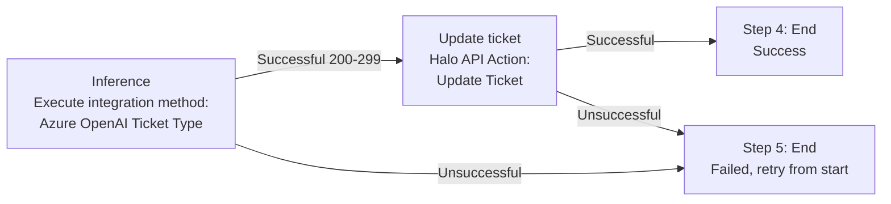

# HaloPSA Azure OpenAI Integration

This is a project I completed on November 5th 2024 as a part of my internship, reformatted using Claude Opus 5.5 and uploaded here as part of my portfolio. 

The process was transferred into a step-by-step guide to connecting HaloPSA to your own Azure OpenAI resource, creating custom OpenAI methods (embeddings and ticket classification), and automating ticket updates with a run book.

> **Status:** Proof of concept, tested in a HaloPSA sandbox. See [Limitations and next steps](#limitations-and-next-steps) before using this in production.

## Table of contents

1. [Prerequisites](#prerequisites)
2. [Create the Azure OpenAI resource](#1-create-the-azure-openai-resource)
3. [Get the endpoint and API key](#2-get-the-endpoint-and-api-key)
4. [Deploy models](#3-deploy-models)
5. [Configure the integration in HaloPSA](#4-configure-the-integration-in-halopsa)
6. [Create custom OpenAI methods](#5-create-custom-openai-methods)
7. [Automate with a runbook](#6-automate-ticket-updates-with-a-runbook)
8. [Limitations and next steps](#limitations-and-next-steps)

## Prerequisites

- A HaloPSA instance (a sandbox is recommended for testing)
- An Azure subscription with access to Azure OpenAI
- Permission to create resources and model deployments in Azure

## 1. Create the Azure OpenAI resource

An endpoint requires an Azure OpenAI resource, so create one first.

1. In the [Azure portal](https://portal.azure.com), select **Azure OpenAI** under *Azure services*.
2. Click **Create**.
3. Under *Project Details*, choose your subscription and resource group. If you don't have a resource group, click **Create new** and name it.
4. Fill in the instance details:
   - **Region:** e.g. East US
   - **Name:** something like `integration-test` or `halo-integrations`
   - **Pricing tier:** Standard S0
5. Click **Next** through the remaining tabs (Network, Tags) until you reach **Review + submit**.
6. Review the terms and details, then click **Create**.

## 2. Get the endpoint and API key

1. Once the resource is created, open it from the Azure OpenAI resource list.
2. Go to **Resource Management > Keys and Endpoint**.
3. Copy the **Endpoint** and either **Key 1** or **Key 2**. You'll paste these into HaloPSA in [step 4](#4-configure-the-integration-in-halopsa).

> **Keep your API key secret.** Don't commit it to source control or paste it into screenshots.

## 3. Deploy models

The resource needs at least one chat model and one embeddings model deployed.

1. In your resource, go to **Model deployments** and click **Manage Deployments** to open Azure OpenAI Studio.
2. Click **Deploy model > Deploy base model**.
3. Choose a model. Azure offers models for embeddings, natural language processing, speech recognition, image generation and more. For HaloPSA you only need:
   - A **chat completion** model (e.g. `gpt-35-turbo`, `gpt-4`)
   - A **text embedding** model (e.g. `text-embedding-ada-002`, `text-embedding-3-small`)
4. Click **Confirm** and give the deployment a name if you wish. Default settings are fine to start.
5. Repeat for the second model.

Note the **deployment names** you choose, because HaloPSA asks for them.

## 4. Configure the integration in HaloPSA

1. Go to **Configuration > Integrations > Azure OpenAI**.
   - If it's greyed out, hover over the button and click the **plus** symbol to enable it.
2. Under **Default AI Connection**, select **Own Azure OpenAI Connection**.
3. Fill in the setup fields:

| Field | Description | Example |
|---|---|---|
| Endpoint | Endpoint copied from Azure | `https://resource-name.openai.azure.com/` |
| API Key | Key 1 or Key 2 from Azure | *(your key)* |
| API Version | Current Azure OpenAI API version | `2024-06-01` |
| Default Azure OpenAI Deployment | Name of your chat deployment | `gpt-35-turbo` |
| Default Azure OpenAI Embeddings Deployment | Name of your embeddings deployment | `text-embedding-ada-002` |

4. Save the configuration.

## 5. Create custom OpenAI methods

Methods let HaloPSA call specific Azure OpenAI APIs and expose the results as variables for use in runbooks.

On the same Azure OpenAI integration screen, scroll to **Custom Integrations** and click **OpenAI Methods**. Click **New** to add a method.

### Method A: Create Embedding

A simple method to start with.

| Setting | Value |
|---|---|
| Name | `Create Embedding` |
| Integration | Azure OpenAI |
| HTTP method | `POST` |
| URL | `{{azureopenai-endpoint}}` followed by the embeddings path for your deployment |
| Body type | JSON |

**Body:**

```json
{
  "model": "text-similarity-ada-002",
  "input": <<ticket^details>>
}
```

**Output variable:**

| Name | Data type | Value |
|---|---|---|
| `AzureOpenAIVector` | Object | `response^data[0]^embedding` |

**Test it:**

1. Click **Test**.
2. Enter a ticket ID for `<<ticket^id>>` and click **Save**.
3. A successful run returns `Response Status=200` and `AzureOpenAIVector=[...]`, a vector of floating-point numbers representing the ticket text.

### Method B: Ticket Type (classification)

This method uses the chat/completions endpoint to classify a ticket and suggest a priority.

| Setting | Value |
|---|---|
| Name | `Ticket type` |
| Integration | Azure OpenAI |
| HTTP method | `POST` |
| URL | `{{azureopenai-endpoint}}/openai/deployments/{{azureopenai-deployment}}/chat/completions` |
| Body type | JSON |

> The URL path is partly cut off in the original screenshots. Check it against the [Azure OpenAI REST reference](https://learn.microsoft.com/azure/ai-services/openai/reference), and confirm the `api-version` query parameter is set under **Query Params**.

**Body:**

```json
{
  "messages": [
    {
      "role": "user",
      "content": "Lists will be in the format of <name: item1, item2, item3>\n <Ticket_Types: New User Onboarding, User Exit, Incident, Service Request> \n You are a service desk technician tasked with creating tickets for a managed services provider in the application HaloPSA \n Give the message a priority number between 1 & 4, 1 being critical and 4 being low priority. How critical the message is should be based on how many users are affected, or if the message is business critical. Return your response in JSON using keys Type as a string and Priority as an integer"
    },
    {
      "role": "user",
      "content": "<<ticket^details>>"
    }
  ]
}
```

**Output variable:**

| Name | Data type | Value | Description |
|---|---|---|---|
| `Ticket Types` | Object | `response^choices[0]^message^content` | Describes the ticket type |

**Test it:**

1. Click **Test** and enter a ticket ID.
2. For a ticket titled *"RDS server not working"* with the detail *"User can't connect to the RDS server"*, the response was:

```json
{
  "Type": "Incident",
  "Priority": 1
}
```

The type is correct, but the priority is not. A single user being unable to connect shouldn't be priority 1 ("all users stopped from working"). This needs better context in the prompt (see [Limitations](#limitations-and-next-steps)).

## 6. Automate ticket updates with a runbook

Create a runbook named **Auto Ticket** that runs when a new ticket is logged and updates it with the AI's output.

### Trigger

- **Event:** New Ticket Logged

### Step 1: Inference (Action)

Executes the Ticket Type method.

| Setting | Value |
|---|---|
| Step name | `Inference` |
| This is the start step | Checked |
| Type | Action |
| Action type | Execute an Integrated Method |
| Method | Azure OpenAI Ticket Type |
| On successful response (200-299) | Move to *Update ticket* |
| On unsuccessful response | Move to the failure end step |

### Step 2: Update ticket (Action)

Takes the output of the inference step and writes it back to the ticket.

| Setting | Value |
|---|---|
| Step name | `Update ticket` |
| Type | Action |
| Action type | Halo API Action |
| Action | Update Ticket |

**JSON body:**

```json
{
  "id": <<ticket^id>>,
  "type": <<Ticket Types>>
}
```

For now only the ticket type is updated, to keep testing and explanation simple.

### Flow chart



### Test the runbook

1. Create a ticket in the sandbox.
2. Check the runbook **Log** tab for a `Completed` status.
3. Open the ticket and confirm the fields were updated. In testing, a ticket titled *"Network issue"* was set to type **Incident** and categorised under Network.

## Limitations and next steps

This is a working prototype. Before relying on it, plan for the following:

- **Improve prompt context.** The model misjudged priority in testing. The prompt needs clearer definitions for each priority level and better examples.
- **Update more fields.** Extend the method and runbook so all relevant ticket fields (priority, category, team and so on) are populated, not just the type.
- **Add human confirmation.** Build a user-controlled step in HaloPSA that requires an agent to confirm the AI's suggestions before they're applied.
- **Validate model output.** Handle malformed or unexpected JSON, for example if the model wraps its answer in a code fence.
- **Align model names.** The embedding example body references `text-similarity-ada-002`, while the sample deployments use `text-embedding-ada-002` / `text-embedding-3-small`. Use the model name that matches your deployment.
- **Review data handling.** Ticket content is sent to Azure OpenAI. Make sure this fits your clients' data policies.
- **Secure credentials.** Rotate keys periodically and restrict who can view the integration settings.
